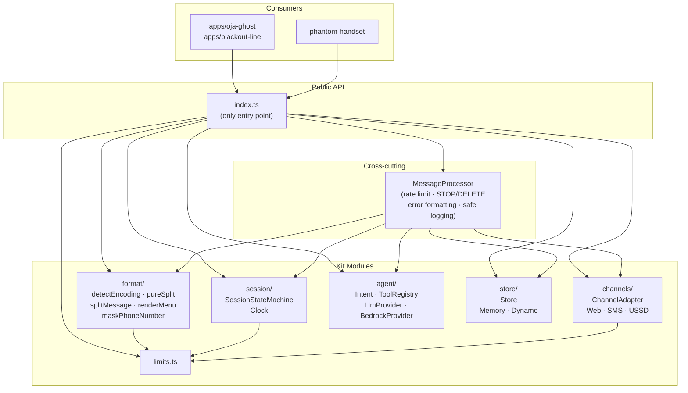
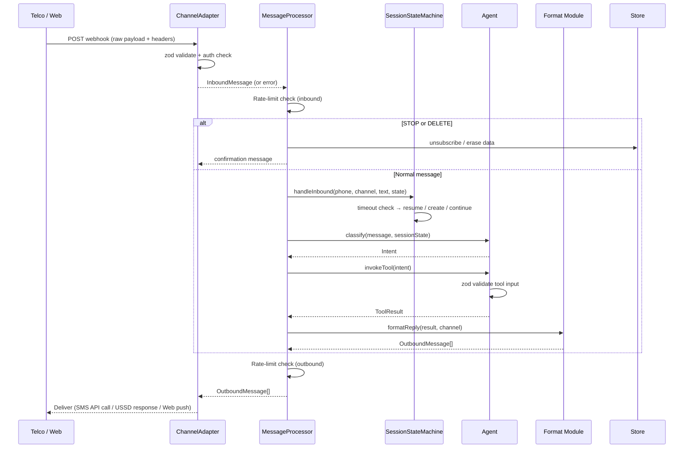

# Design Document: kit-core

## Overview

The `@ghostline/kit` package is the skeleton library that every Ghost Line Kit app builds on. It provides five component areas — channel adapters, a session state machine, a format module, an agent core, and a store — plus cross-cutting concerns (rate limiting, STOP/DELETE handling, phone-number masking, safe logging) that every app needs. Apps import only from `@ghostline/kit` and never from kit internals.

The design follows three principles:

1. **Pure functions for testable logic.** Message splitting, encoding detection, menu rendering, phone-number masking, and session-state transitions are pure functions or pure state-machine transitions. They take inputs and return outputs without side effects, so property-based tests with fast-check can generate thousands of random inputs and verify universal properties. Side-effectful code (sending SMS, writing to DynamoDB, calling Bedrock) lives behind interfaces with mockable implementations.

2. **Interfaces for swappable backends.** `ChannelAdapter`, `LlmProvider`, and `Store` are interfaces. Each has at least two implementations: an in-process or in-memory version for tests and development, and a production version backed by a real service. Apps depend on the interface, not the implementation, so backends can be swapped without touching app logic.

3. **Single source of truth for limits.** Every channel character limit, segment size, timeout, and rate-limit threshold lives in `kit/src/limits.ts`. All other modules import from there and never hardcode their own copies. Changing a limit in one place propagates everywhere.

### Research Notes

**GSM-7 character set.** The GSM 7-bit default alphabet (3GPP TS 23.038) contains 128 basic characters: Latin letters a–z and A–Z, digits 0–9, common punctuation (`! " # $ % & ' ( ) * + , - . / : ; < = > ? _`), space, `@`, and a handful of accented and Greek characters. Characters outside this set (emoji, most CJK, `{}[]|^~\`) force UCS-2 encoding. The extension table adds a few characters via an escape mechanism, but for segment-counting purposes they still count as GSM-7. Sources: [Wikipedia GSM 03.38](https://en.wikipedia.org/wiki/GSM_03.38), [Sinch SMS character support](https://developers.sinch.com/docs/sms/resources/message-info/character-support).

**Africa's Talking API.** The SMS send endpoint is a form-encoded POST to `https://api.africastalking.com/version1/messaging` with an `apiKey` header. The USSD flow is synchronous: AT sends a POST to the app's callback URL with `sessionId`, `phoneNumber`, `serviceCode`, and `text` parameters; the app responds with plain text prefixed by `CON ` (show another screen) or `END ` (end session). The sandbox uses `username: "sandbox"`. The kit calls the REST API directly via `fetch` (built into Node 20+) rather than importing the `africastalking` npm SDK, avoiding an extra dependency. Sources: [Africa's Talking USSD API](https://africastalking.com/ussd-api), [Africa's Talking sandbox docs](https://help.africastalking.com/en/articles/1170660-how-do-i-get-started-on-the-africa-s-talking-sandbox).

**Design decision: fetch over the AT SDK.** The constraints name hono, zod, vitest, and fast-check as the allowed dependencies. The `africastalking` npm package is not on that list. The REST API is simple enough to call with `fetch`, and using `fetch` makes the adapters trivially mockable in tests. This avoids adding a dependency and keeps the adapter layer thin.

**AWS SDK v3.** The `BedrockProvider` and `DynamoStore` require `@aws-sdk/client-bedrock-runtime` and `@aws-sdk/client-dynamodb` (with `@aws-sdk/lib-dynamodb` for the document client). These are new dependencies that need to be added. They are imported only inside the respective implementation files, never in the interfaces, so the interfaces remain SDK-free.

## Architecture

### Module Map



All arrows from `INDEX` are re-exports. Apps and the Phantom Handset import only from `@ghostline/kit` (resolved by the `exports` field in `kit/package.json` to `./src/index.ts`). Subpath imports like `@ghostline/kit/src/format/split` are not resolvable because the `exports` map does not list them — this is how public-API encapsulation is enforced.

### Inbound Message Flow



The `MessageProcessor` is the orchestrator that ties the components together. It is the only kit component with side-effectful orchestration logic; the individual modules it calls are pure or behind interfaces. Apps create a `MessageProcessor` with their configured adapters, store, and agent, then call `process(inbound)` for each inbound message.

## Components and Interfaces

### Limits Module (`limits.ts`)

A single frozen object exporting every channel limit. All other modules import from here.

```typescript
export const LIMITS = {
  sms: {
    gsm7: { singleSegment: 160, concatSegment: 153 },
    ucs2: { singleSegment: 70,  concatSegment: 67  },
  },
  ussd: {
    screenHardCap:   160,
    screenSoftTarget: 140,
    sessionTimeoutMs: 180_000,
    maxOptionsPerScreen: 5,
  },
  reply: {
    maxPreferredSegments: 3,
    nextStepMaxLength: 40,
  },
  rateLimit: {
    windowMs:    60_000,
    maxInbound:  10,
    maxOutbound: 10,
  },
} as const;
```

Every other module that needs a limit imports `LIMITS` and reads the relevant field. No module defines its own copy of any value in `LIMITS`.

### Format Module (`format/`)

All formatting functions are pure. Four submodules:

**Encoding detection** (`format/encoding.ts`):
- `detectEncoding(text: string): Encoding` — returns `'GSM-7'` if every character is in the GSM-7 basic alphabet, otherwise `'UCS-2'`. The GSM-7 alphabet is a `Set<string>` built once at module load from the 3GPP TS 23.038 default alphabet.
- `GSM7_CHARS: ReadonlySet<string>` — exported for use in generators and tests.

**Message splitting** (`format/split.ts`):
- `pureSplit(text: string, encoding: Encoding): string[]` — the Pure_Splitter. Determines whether the message fits in a single segment (using the single-segment limit) or needs concatenation (using the per-segment limit). Tokenises by whitespace, keeping whitespace tokens, then greedily fills segments. Never splits a non-whitespace token (atomic unit) across segments unless the token itself exceeds the segment limit (Requirement 5.6), in which case it hard-splits at a character boundary. Concatenating the returned segments yields the original text.
- `splitMessage(text: string): SplitResult` — the full split. Calls `detectEncoding` then `pureSplit`. If the result exceeds `LIMITS.reply.maxPreferredSegments` (3), applies the summary step: keeps the leading segments, trims the last at a word boundary, and appends `" Reply MORE"` to the final segment. Returns a `SplitResult` with `truncated: true` when the summary step fired.

**Menu rendering** (`format/menu.ts`):
- `renderMenuScreen(options: MenuOption[], offset: number, config?: Partial<MenuConfig>): string` — renders one USSD screen with up to 5 numbered options (1–5) plus `0 Back` and `00 Menu`. Returns text ≤160 characters.
- `renderMenuScreens(options: MenuOption[], config?: Partial<MenuConfig>): string[]` — renders all screens for a menu with more than 5 options, splitting across subsequent screens.

**Phone masking** (`format/phone.ts`):
- `maskPhoneNumber(phone: string): string` — if the phone number has more than 7 digits, keeps the first 3 and last 4 digits visible and masks the rest. If 7 or fewer digits, keeps only the last 2 visible. Non-digit characters (like `+`) are preserved.

**Reply formatting** (`format/reply.ts`):
- `formatReply(content: string, opts: ReplyOpts): OutboundMessage` — detects encoding, splits into segments, and appends a next-step instruction (≤40 chars) to the final segment or screen when the reply continues an active conversation. If the next-step instruction would overflow the final segment, it goes in an additional segment. Never appends a next step to STOP, DELETE, or session-end acknowledgments.

### Channel Adapters (`channels/`)

**Interface** (`channels/types.ts`):

```typescript
interface ChannelAdapter {
  readonly channel: ChannelType;

  /** Send an outbound message via the channel. */
  send(message: OutboundMessage): Promise<SendResult>;

  /** Parse, validate (zod), and authenticate an inbound webhook payload. */
  parseWebhook(
    rawPayload: unknown,
    headers: Record<string, string>,
  ): WebhookResult;

  /** Subscribe to delivery-status events. Returns an unsubscribe function. */
  onDeliveryStatus(handler: (status: DeliveryStatus) => void): () => void;
}
```

Each adapter also exports a zod schema for its webhook payload and an optional `formatResponse` helper for channels where the HTTP response body IS the outbound delivery (USSD).

**WebAdapter** (`channels/web-adapter.ts`):
- Powers the Phantom Handset browser emulator. No real telco, no webhook authentication.
- `send()` delivers the message via a registered callback (`onDeliver`); the Phantom Handset's server-side hook calls this callback to push messages to the connected browser.
- `parseWebhook()` validates the browser-originated payload with a zod schema (`{ from: string, text: string, sessionId?: string }`).
- Delivery status is simulated: `send()` returns `{ ok: true, messageId }` immediately.

**SmsAdapter** (`channels/sms-adapter.ts`):
- Sends SMS via the Africa's Talking REST API using `fetch`. Constructor takes `{ username, apiKey, shortcode?, webhookSecret? }`.
- `send()` POSTs form-encoded data to `https://api.africastalking.com/version1/messaging`. Returns `{ ok, messageId?, error? }`. If the API returns an error, returns `{ ok: false, error }` and preserves prior state.
- `parseWebhook()` validates the inbound SMS payload with zod, checks the webhook secret (shared secret in a header or query parameter), and returns an `InboundMessage` or a `WebhookResult` error.

**UssdAdapter** (`channels/ussd-adapter.ts`):
- Handles USSD sessions via Africa's Talking. Same constructor shape as SmsAdapter.
- `send()` is synchronous: it formats the response text with a `CON ` or `END ` prefix (based on `OutboundMessage.endSession`) and returns it in `SendResult.responseText`. The app's HTTP handler returns this as the response body.
- `parseWebhook()` validates the USSD callback payload (`sessionId`, `phoneNumber`, `serviceCode`, `text`) with zod and returns an `InboundMessage` with `sessionId` set.
- `formatResponse(message: OutboundMessage): string` — exported helper that returns `"CON " + text` or `"END " + text`.

### Session State Machine (`session/`)

**Clock** (`session/clock.ts`):
- `Clock` interface with a single method: `now(): number` (returns milliseconds).
- `SystemClock` uses `Date.now()`.
- `TestClock` holds a mutable counter with `advance(ms)` and `set(ms)` methods, for deterministic timeout testing.

**Pure transition function** (`session/session-state-machine.ts`):
- `sessionTransition(current: SessionState | undefined, event: SessionEvent, nowMs: number, timeoutMs: number): SessionState | undefined` — the pure state-machine step. This is the function PBT targets. It takes the current session state (or `undefined` if none exists), an event, the current clock time, and the timeout threshold, and returns the new state (or `undefined` if the session was ended/removed).

  Event types:
  - `{ type: 'inbound', conversationState: unknown }` — creates a session if none exists; resumes a timed-out session to active with the app-provided new conversation state; updates an active session.
  - `{ type: 'check' }` — computes whether the session has timed out based on `nowMs - lastInboundMs >= timeoutMs` and returns the state with `status: 'timed-out'` if so. Does not modify conversation state.
  - `{ type: 'end' }` — returns `undefined` (session removed).

**SessionStateMachine class** — wraps the pure transition function with `Store` persistence and the injected `Clock`. The app calls `handleInbound(phone, channel, text, conversationState)` or `endSession(phone, channel)`. The class loads the session from the store, calls `sessionTransition`, and writes the result back. Timeout is computed lazily on each access using the clock.

### Agent (`agent/`)

**Intent** (`agent/intent.ts`):
- `Intent` type: `{ name: string, parameters: Record<string, string | number | boolean>, rawMessage: string }`.
- `IntentSchema` — a zod schema matching the `Intent` type, used for validation and as the serialization format.
- `serializeIntent(intent: Intent): string` — serialises to JSON string.
- `parseIntent(json: string): Intent` — parses from JSON string, validating with `IntentSchema`.

**Tool registry** (`agent/tool-registry.ts`):
- `Tool` interface: `{ name: string, description: string, inputSchema: z.ZodType, execute: (input: unknown) => Promise<unknown> }`.
- `ToolRegistry` class: `register(tool: Tool)`, `get(name: string): Tool | undefined`, `invoke(name: string, input: unknown): Promise<ToolResult>`. `invoke` validates input against the tool's zod schema before executing. If validation fails or the tool name is unregistered, returns an error result with a user-facing message ≤160 characters.

**Agent** (`agent/agent.ts`):
- `Agent` class: constructed with `{ llm: LlmProvider, tools: ToolRegistry, intentNames: string[] }`.
- `classify(message: string): Promise<Intent>` — uses the `LlmProvider` to classify the message into one of the registered intent names, or into the `'unrecognized'` intent if no match.
- `invokeTool(name: string, input: unknown): Promise<ToolResult>` — delegates to the `ToolRegistry`.

**LlmProvider** (`agent/llm-provider.ts`):
- `LlmProvider` interface: `{ complete(prompt: string): Promise<string>, classifyIntent(message: string, intentNames: string[]): Promise<Intent> }`.

**BedrockProvider** (`agent/bedrock-provider.ts`):
- Implements `LlmProvider` using `@aws-sdk/client-bedrock-runtime`. Constructor takes `{ modelId: string, region: string, client?: BedrockRuntimeClient }`. The client is injectable so tests can pass a mock.
- `complete()` calls the Bedrock `InvokeModel` API and extracts the text from the response.
- `classifyIntent()` prompts the model to return a JSON Intent and parses it with `IntentSchema`. If the model returns an intent name not in `intentNames`, classifies as `'unrecognized'`.
- If Bedrock returns an error or is unavailable, surfaces a `KitError` to the application layer rather than propagating the raw SDK error.

### Store (`store/`)

**Interface** (`store/store.ts`):
- `Store` interface: `read<T>(key: string): Promise<T | undefined>`, `write<T>(key: string, value: T): Promise<void>`, `delete(key: string): Promise<void>`. Each operation is keyed by a string identifier. If an operation fails, the implementation surfaces an error and preserves previously persisted data.

**MemoryStore** (`store/memory-store.ts`):
- Backed by a `Map<string, unknown>`. All operations are synchronous internally but return Promises for interface conformance. Used in tests and development.

**DynamoStore** (`store/dynamo-store.ts`):
- Backed by `@aws-sdk/lib-dynamodb`. Constructor takes `{ tableName: string, client?: DynamoDBDocumentClient }`. The client is injectable for testing. Stores values as JSON-serialised attributes.

### Message Processor (`processor.ts`)

The orchestrator that wires the components together and handles cross-cutting concerns:

```typescript
class MessageProcessor {
  constructor(config: {
    adapter: ChannelAdapter;
    store: Store;
    session: SessionStateMachine;
    agent: Agent;
    clock: Clock;
    rateLimiter: RateLimiter;
    logger: SafeLogger;
  });

  async process(inbound: InboundMessage): Promise<OutboundMessage[]>;
}
```

The `process()` pipeline:
1. **Rate-limit check (inbound)** — if the phone number has exceeded `LIMITS.rateLimit.maxInbound` in the last `windowMs`, return a rate-limit error message.
2. **STOP / DELETE** — if the message text (trimmed, uppercased) is `STOP`, unsubscribe the phone number and return a confirmation. If `DELETE`, erase stored data and return a confirmation. If `STOP` and the user is not subscribed, return a "not subscribed" message.
3. **Session** — call `SessionStateMachine.handleInbound()` to get or resume the session and its preserved conversation state.
4. **Classify** — `Agent.classify(message)` produces an `Intent`.
5. **Invoke tool** — `Agent.invokeTool(intent)` runs the tool, returning a `ToolResult`.
6. **Format reply** — `formatReply(toolResult, { channel })` splits and formats the reply for the channel, appending a next-step instruction where appropriate.
7. **Rate-limit check (outbound)** — track outbound messages against the limit.
8. **Log** — log message ID, length, and status via `SafeLogger`. Never log the message body.

### Rate Limiter (`rate-limiter.ts`)

A pure function for testability:

```typescript
interface RateLimitState {
  inbound: number[];   // timestamps of recent inbound messages
  outbound: number[];  // timestamps of recent outbound messages
}

function checkRateLimit(
  state: RateLimitState,
  direction: 'inbound' | 'outbound',
  nowMs: number,
  limits: { windowMs: number; max: number },
): { allowed: boolean; newState: RateLimitState };
```

The function filters out timestamps older than `windowMs`, counts the remaining entries, and returns `allowed: true` if the count is below `max`, along with the updated state (which includes the new timestamp if allowed).

### Safe Logger (`logger.ts`)

```typescript
interface SafeLogger {
  info(event: { messageId?: string; phoneNumber?: string; messageLength?: number; event: string }): void;
  error(event: { messageId?: string; phoneNumber?: string; messageLength?: number; error: string }): void;
}
```

The `ProductionLogger` implementation logs only message IDs, message lengths, error indications, and masked phone numbers. It never logs message bodies. The `DevLogger` is more verbose but still masks phone numbers and omits message bodies. Both use `maskPhoneNumber` from the format module.

### Errors (`errors.ts`)

```typescript
class KitError extends Error {
  /** Short, actionable message shown to the user (≤160 chars, no stack traces or internal IDs). */
  readonly userMessage: string;
  /** Internal error detail for logs only, never shown to users. */
  readonly internalMessage: string;
}
```

Every error that reaches the user goes through `KitError`. The `userMessage` is at most 160 characters, excludes stack traces and internal identifiers, and includes at least one suggested recovery action (e.g., `"Try again. Send HELP for options."`). The `internalMessage` is logged but never sent to the user.

## Data Models

### Encoding and Splitting

```typescript
type Encoding = 'GSM-7' | 'UCS-2';

interface SplitResult {
  segments: string[];    // the message segments
  truncated: boolean;     // true if the summary step was applied
  encoding: Encoding;     // detected encoding
  segmentCount: number;   // number of segments emitted
}
```

### Menus

```typescript
interface MenuOption {
  label: string;   // option text shown to the user (e.g., "Check prices")
  value: string;    // value returned when the user selects this option (e.g., "1")
}

interface MenuConfig {
  title: string;       // optional title line above the options
  backLabel: string;   // default: "Back"
  menuLabel: string;   // default: "Menu"
}
```

### Channel Messages

```typescript
type ChannelType = 'sms' | 'ussd' | 'web';

interface OutboundMessage {
  to: string;             // recipient phone number (unmasked in transit, masked in logs)
  text: string;           // message content
  sessionId?: string;     // USSD session identifier for continuation
  endSession?: boolean;   // USSD: true = END (close session), false/undefined = CON (continue)
}

interface InboundMessage {
  from: string;           // sender phone number
  text: string;           // user input
  channel: ChannelType;
  sessionId?: string;     // USSD session identifier
  timestamp: number;      // epoch milliseconds
  messageId?: string;     // telco-assigned message ID (for delivery tracking)
}

interface SendResult {
  ok: boolean;
  messageId?: string;     // telco-assigned ID for delivery tracking
  error?: string;         // internal error description (never shown to users)
  responseText?: string;  // USSD: formatted response ("CON ..." or "END ...") for the HTTP body
}

type WebhookResult =
  | { ok: true; inbound: InboundMessage }
  | { ok: false; error: { code: string; message: string } };

interface DeliveryStatus {
  messageId: string;
  status: 'delivered' | 'failed' | 'pending';
  phoneNumber: string;    // masked in logs
}
```

### Session

```typescript
type SessionStatus = 'active' | 'timed-out' | 'ended';

interface SessionState<T = unknown> {
  phoneNumber: string;
  channel: ChannelType;
  conversationState: T;    // app-specific conversation state
  lastInboundMs: number;    // timestamp of the last inbound message
  status: SessionStatus;
}

type SessionEvent =
  | { type: 'inbound'; conversationState: unknown }
  | { type: 'check' }
  | { type: 'end' };

interface Clock {
  now(): number;    // epoch milliseconds
}
```

### Agent

```typescript
interface Intent {
  name: string;
  parameters: Record<string, string | number | boolean>;
  rawMessage: string;
}

interface Tool {
  name: string;
  description: string;
  inputSchema: z.ZodType;
  execute: (input: unknown) => Promise<unknown>;
}

type ToolResult =
  | { ok: true; output: unknown }
  | { ok: false; userMessage: string };  // ≤160 chars, actionable

interface LlmProvider {
  complete(prompt: string): Promise<string>;
  classifyIntent(message: string, intentNames: string[]): Promise<Intent>;
}
```

### Store

```typescript
interface Store {
  read<T>(key: string): Promise<T | undefined>;
  write<T>(key: string, value: T): Promise<void>;
  delete(key: string): Promise<void>;
}
```

### Rate Limiter

```typescript
interface RateLimitState {
  inbound: number[];   // timestamps of recent inbound messages
  outbound: number[];  // timestamps of recent outbound messages
}

interface RateLimitConfig {
  windowMs: number;
  maxInbound: number;
  maxOutbound: number;
}
```

### Reply Formatting

```typescript
interface ReplyOpts {
  channel: ChannelType;
  continueConversation: boolean;  // false for STOP/DELETE/session-end acks
  nextStep?: string;              // next-step instruction (≤40 chars), e.g., "Reply 1 to confirm"
}

interface ReplyResult {
  message: OutboundMessage;
  segments: string[];
  encoding: Encoding;
}
```

## Correctness Properties

*A property is a characteristic or behavior that should hold true across all valid executions of a system — essentially, a formal statement about what the system should do. Properties serve as the bridge between human-readable specifications and machine-verifiable correctness guarantees.*

The kit's pure functions and state-machine transitions are verified with property-based tests using fast-check. Each property below is a universally quantified statement that must hold for all valid inputs. Properties are consolidated where multiple acceptance criteria test the same underlying behavior.

### Property 1: Encoding detection correctness

*For any* string, `detectEncoding` SHALL return `'GSM-7'` if and only if every character in the string is in the GSM-7 default alphabet, and `'UCS-2'` otherwise.

**Validates: Requirements 4.1, 4.2, 4.3**

Generator: two branches — (a) strings composed only of GSM-7 alphabet characters, (b) strings containing at least one character outside the GSM-7 alphabet (e.g., emoji, CJK, `{}|^~`).

### Property 2: Segment limit compliance

*For any* message text, every segment produced by `pureSplit` SHALL be within the character limit for the detected encoding: 160 characters (GSM-7 single) or 70 characters (UCS-2 single) when the message fits in one segment, and 153 characters (GSM-7 concatenated) or 67 characters (UCS-2 concatenated) per segment when it does not.

**Validates: Requirements 5.1, 5.3**

Generator: random strings of varying lengths, including strings just under and just over the single-segment boundary. Constrain non-whitespace token lengths to be within the segment limit (the hard-split exception from 5.6 is tested separately as an edge case).

### Property 3: Split round-trip

*For any* message text whose segment count from `pureSplit` does not exceed `maxPreferredSegments` (3), concatenating the resulting segments SHALL yield the original message text exactly.

**Validates: Requirements 5.4**

Generator: random strings whose length is such that `pureSplit` produces at most 3 segments. Include strings with leading/trailing whitespace, multiple consecutive spaces, single-character words, and mixed GSM-7/UCS-2 content.

### Property 4: No atomic unit split across segments

*For any* message text where every non-whitespace token is no longer than the concatenated segment limit, no segment boundary produced by `pureSplit` SHALL fall inside a word (maximal non-whitespace run), number (maximal run of digits and separators), currency amount (currency symbol adjacent to its digits), or phone number.

**Validates: Requirements 5.2, 5.5**

Generator: strings composed of words, numbers (e.g., `1,500`, `3.14`), currency amounts (e.g., `₦1,500`), and phone numbers (e.g., `+2348051234567`), separated by single spaces. Constrain each token to be within the segment limit.

### Property 5: Menu screen character limit

*For any* set of menu options (any count, any label lengths), every screen rendered by `renderMenuScreens` SHALL be at most 160 characters.

**Validates: Requirements 6.2, 6.4**

Generator: arrays of `MenuOption` objects with random labels of varying lengths (1–50 characters). Include arrays with 1 option, 5 options, and more than 5 options (multi-screen).

### Property 6: No atomic unit split across USSD screens

*For any* set of menu options, no USSD screen boundary produced by `renderMenuScreens` SHALL fall inside a word, number, currency amount, or phone number.

**Validates: Requirements 6.3**

Generator: arrays of `MenuOption` objects whose labels contain words, numbers, currency amounts, and phone numbers, with varying label lengths that push against the 160-character screen cap.

### Property 7: Session state machine correctness

*For all* sequences of session events (inbound message, clock advance, explicit end) applied to a session with an injected clock: (a) after 180 seconds or more of inactivity since the last inbound message, the session status SHALL be `timed-out` and the stored conversation state SHALL equal the conversation state at the time of the last inbound message; (b) the next inbound message on a timed-out session SHALL resume to `active` with exactly the preserved conversation state; (c) after an explicit end-session signal, the session record SHALL no longer be retrievable; (d) after 180 seconds or more have elapsed since the last inbound message, the session status SHALL NOT be `active`.

**Validates: Requirements 8.2, 8.3, 8.4, 8.6**

Generator: sequences of events where each event is randomly one of: `{ type: 'inbound', conversationState: <random> }`, `{ type: 'advance', ms: <random 0–300000> }`, `{ type: 'end' }`, or `{ type: 'check' }`. The test applies events in order using a `TestClock`, and after each event asserts the applicable sub-property. The injected clock (Requirement 8.5) makes time advancement deterministic.

### Property 8: Intent serialization round-trip

*For any* valid `Intent` (any intent name, any parameter names and values of type string, number, or boolean, any raw message), serializing the intent to JSON and parsing it back SHALL produce an `Intent` with the same intent name and the same parameter names and values as the original.

**Validates: Requirements 9.3, 9.4**

Generator: `fc.record({ name: fc.string(), parameters: fc.dictionary(fc.string(), fc.oneof(fc.string(), fc.integer(), fc.boolean())), rawMessage: fc.string() })`.

### Property 9: Phone number masking

*For any* phone number string, `maskPhoneNumber` SHALL preserve only the first 3 and last 4 digit characters when the number contains more than 7 digits, and only the last 2 digit characters when it contains 7 or fewer digits. No other original digit characters SHALL appear in the masked output. Non-digit characters SHALL be preserved as-is.

**Validates: Requirements 14.1, 14.2, 14.3**

Generator: two branches — (a) strings with more than 7 digit characters (8–20 digits, mixed with optional `+` prefix and non-digit separators), (b) strings with 1–7 digit characters. Verify that the masked output contains exactly the expected visible digits and that all other original digits are replaced with the mask character.

### Property 10: Rate limit correctness

*For any* rate-limit state and new message timestamp, `checkRateLimit` SHALL allow the message if and only if the count of messages within the preceding `windowMs` is below the maximum (10). When all prior message timestamps have expired from the window, the next message SHALL be allowed and the new state SHALL contain only the new timestamp.

**Validates: Requirements 16.1, 16.2, 16.3**

Generator: rate-limit states with 0–15 timestamps at varying ages relative to `nowMs` (some within the window, some expired), combined with the current `nowMs`. Assert: `allowed === (recentCount < max)`. When all timestamps are older than `windowMs`, assert `allowed === true` and the new state has only the new timestamp.

## Error Handling

### Error philosophy

Every error that reaches a user is short, actionable, and free of technical detail. The kit never sends stack traces, internal IDs, or raw SDK errors to a phone. Internal error details are logged but never transmitted.

### KitError

```typescript
class KitError extends Error {
  readonly userMessage: string;     // ≤160 chars, actionable, no stack traces or IDs
  readonly internalMessage: string; // for logs only, never sent to users
  readonly code: string;            // internal error code (e.g., 'AT_API_ERROR', 'RATE_LIMITED')
}
```

The `userMessage` always includes at least one recovery action. Examples:
- Rate limited: `"Too many messages. Wait 1 min and try again."`
- Tool validation failed: `"That didn't work. Send HELP for options."`
- Store error: `"Service briefly unavailable. Try again in a moment."`
- Bedrock unavailable: `"Service briefly unavailable. Try again in a moment."`

### Error flow by component

| Component | Error source | User-facing result | Logged detail |
|---|---|---|---|
| ChannelAdapter (webhook) | Zod validation failure | `WebhookResult` error (rejected, not processed) | Error code + masked phone |
| ChannelAdapter (webhook) | Signature mismatch | `WebhookResult` error (rejected) | Error code + masked phone |
| SmsAdapter / UssdAdapter | AT API error | `SendResult` error (message not sent) | HTTP status + error body |
| SmsAdapter / UssdAdapter | Missing credentials | `SendResult` error (config failure) | Missing env var name |
| Agent (classify) | LlmProvider error | `KitError` with generic message | Model ID + error text |
| Agent (invokeTool) | Zod validation failure | `ToolResult` error (≤160 chars, actionable) | Tool name + validation errors |
| Agent (invokeTool) | Unregistered tool | `ToolResult` error | Tool name |
| Store | Read/write/delete failure | `KitError` with generic message | Operation + key (not value) |
| Rate limiter | Limit exceeded | Rate-limit error message (≤160 chars) | Phone (masked) + counts |
| MessageProcessor | Any unhandled error | Generic error message (≤160 chars) | Full error stack in logs only |

### Defense in depth

1. **Channel adapter** rejects invalid or unauthenticated webhooks before any processing.
2. **MessageProcessor** wraps all processing in a try/catch. Any unhandled error becomes a `KitError` with a generic user message.
3. **SafeLogger** ensures that even if an error contains sensitive data, only safe fields reach the log output.

## Testing Strategy

### Dual testing approach

The kit uses three test layers:

1. **Property-based tests (PBT)** — universal properties over generated inputs, using fast-check. Each runs a minimum of 100 iterations (`FC_NUM_RUNS=100` in normal test runs, `FC_NUM_RUNS=1000` in `pnpm test:pbt`). Target the kit's pure functions and state-machine transitions.
2. **Example-based unit tests** — specific scenarios, edge cases, and integration between components. Cover the deterministic behaviours that PBT does not target (summary step, STOP/DELETE, tool validation failures, menu format).
3. **Integration tests** — external service interactions with mocked HTTP/SDK clients. Cover Africa's Talking API calls, DynamoDB operations, and Bedrock model invocations.

### PBT test files

PBT test files use the `*.pbt.test.ts` naming convention so `pnpm test:pbt` can select them.

| Test file | Property | Function under test | Generator notes |
|---|---|---|---|
| `kit/test/encoding.pbt.test.ts` | 1: Encoding detection | `detectEncoding` | GSM-7 charset generator + non-GSM-7 generator |
| `kit/test/split.pbt.test.ts` | 2: Segment limit compliance | `pureSplit` | Random strings, token lengths ≤ segment limit |
| `kit/test/split.pbt.test.ts` | 3: Split round-trip | `pureSplit` | Strings producing ≤3 segments, varied whitespace |
| `kit/test/split.pbt.test.ts` | 4: No atomic unit split | `pureSplit` | Words, numbers, currency, phone numbers |
| `kit/test/menu.pbt.test.ts` | 5: Menu screen limit | `renderMenuScreens` | Random MenuOption arrays |
| `kit/test/menu.pbt.test.ts` | 6: No atomic unit split (USSD) | `renderMenuScreens` | Labels with atomic units at screen boundary |
| `kit/test/session.pbt.test.ts` | 7: Session state machine | `sessionTransition` | Random event sequences with TestClock |
| `kit/test/intent.pbt.test.ts` | 8: Intent round-trip | `serializeIntent`/`parseIntent` | Random Intent objects |
| `kit/test/phone.pbt.test.ts` | 9: Phone masking | `maskPhoneNumber` | Phone strings with varying digit counts |
| `kit/test/rate-limit.pbt.test.ts` | 10: Rate limit | `checkRateLimit` | Random timestamp states + nowMs |

Each PBT test is tagged with a comment referencing the design property:
```typescript
// Feature: kit-core, Property 3: Split round-trip
```

### Example-based test files

| Test file | Criteria | What it tests |
|---|---|---|
| `kit/test/limits.test.ts` | 1.1–1.9 | LIMITS constant values |
| `kit/test/split.test.ts` | 5.6, 5.7, 5.8 | Hard-split edge case; summary step (3 segs, 4 segs, currency at boundary) |
| `kit/test/menu.test.ts` | 6.1, 6.5, 6.6 | Menu format (5 options + Back + Menu); soft target at 140; multi-screen for >5 options |
| `kit/test/reply.test.ts` | 7.1, 7.2 | Next-step appended; overflow → additional segment |
| `kit/test/agent.test.ts` | 9.5, 10.2, 10.3, 10.4 | Unrecognized intent; tool validation; validation failure error; unregistered tool |
| `kit/test/errors.test.ts` | 17.1, 17.2, 17.3 | Error ≤160 chars; no stack traces; includes recovery action |
| `kit/test/stop-delete.test.ts` | 15.1, 15.2, 15.3 | STOP unsubscribes + confirms; DELETE erases + confirms; STOP not subscribed |
| `kit/test/encapsulation.test.ts` | 13.1, 13.2, 13.3 | Public API exports; subpath imports fail |

### Integration test files

| Test file | Criteria | What it tests |
|---|---|---|
| `kit/test/channels.test.ts` | 2.2, 2.3, 2.5, 2.6, 3.1–3.6 | Webhook zod validation; signature check; delivery status; AT API send/initiate/continue with mocked `fetch`; API error handling; missing credentials |
| `kit/test/bedrock.test.ts` | 11.2, 11.4 | BedrockProvider complete + classifyIntent with mocked client; error → KitError |
| `kit/test/store-dynamo.test.ts` | 12.3, 12.4 | DynamoStore read/write/delete with mocked client; failure preserves data |
| `kit/test/logger.test.ts` | 18.1, 18.2, 18.3 | ProductionLogger logs only IDs/lengths/errors; never logs bodies; masks phones |

### Counterexample handling

When a property test finds a counterexample, fast-check shrinks it to a minimal failing case. The test file keeps the counterexample as a named regression example with a comment describing the bug it found:

```typescript
// Regression: pureSplit split "₦1,500" across two segments when the
// currency amount landed exactly at the 153-char boundary.
it('regression: currency amount at segment boundary', () => {
  const input = 'word '.repeat(30) + '₦1,500';
  const segments = pureSplit(input, 'GSM-7');
  expect(segments.some(s => s.includes('₦1,500'))).toBe(true);
});
```

This record serves as evidence for the hackathon write-up.

### What is NOT property-tested

The following are tested with examples or integration tests, not PBT, because they are deterministic, side-effectful, or external:

- **Summary step** (5.7, 5.8) — deterministic for a given input length; named example tests.
- **STOP / DELETE handling** (15.1–15.3) — stateful store operations; example tests.
- **Channel adapters** (2.2–2.6, 3.1–3.6) — external API integration; integration tests with mocks.
- **BedrockProvider** (11.2, 11.4) — external LLM integration; integration tests with mocked client.
- **DynamoStore** (12.3, 12.4) — external storage integration; integration tests with mocked client.
- **Logger** (18.1–18.3) — side-effectful output; integration tests with captured output.
- **Error message safety** (17.1–17.3) — construction invariants; example tests.
- **Public API encapsulation** (13.1–13.3) — structural/architectural; smoke tests.
- **Limits constants** (1.1–1.9) — fixed values; smoke tests.

### Open questions

1. **Africa's Talking webhook authentication mechanism.** The requirements specify "shared secret or IP allowlist." Africa's Talking's exact webhook signature mechanism (header name, format) needs to be verified against their current documentation. The adapter design supports both approaches; the specific header to check is an implementation detail.

2. **AWS SDK v3 packages.** `@aws-sdk/client-bedrock-runtime` and `@aws-sdk/client-dynamodb` (+ `@aws-sdk/lib-dynamodb`) are new dependencies. They are imported only inside `BedrockProvider` and `DynamoStore`, never in interfaces or public types. Adding them requires updating `kit/package.json`. This should be confirmed before implementation.

3. **Bedrock model invocation format.** The exact request/response format depends on the model ID chosen (e.g., Claude vs. other models). The `BedrockProvider` should handle the model-specific payload format internally and expose only the `LlmProvider` interface.
