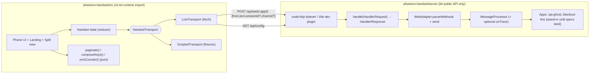

# Design Document

## Overview

The Phantom Handset is a Vite + React + TypeScript single-page app plus a thin Node server, both in `/phantom-handset`.

- **Browser app** (`src/`): a pure UI client. It renders the retro phone, the landing page, and the split view with the trace panel. It never imports `@ghostline/kit` at runtime (`import type` only). It gets replies from one of two interchangeable transports: `LiveTransport` (HTTP) or `ScriptedTransport` (fixtures, no network).
- **Server** (`server/`): a pure `handle(request) → response` function that wires `WebAdapter`, `MessageProcessor` and the apps using only the public `@ghostline/kit` API. A small `node:http` wrapper serves it in development. A Lambda wrapper can be added later without touching the handler. No new runtime dependency is added.
- **Pure modules** (`src/lcd`, `src/keypad`, `src/sms`): the LCD paginator, the key-sequence composer and the SMS counter. They have no React or DOM imports, so property tests can run them directly.

Decisions already approved (requirements review): plain `node:http` around the pure handler (no `@hono/node-server`), hand-written type guards in the browser (no zod), and channel limits fetched from the server.

### Architecture



### File layout

```
phantom-handset/
  index.html  vite.config.ts  tsconfig.json  tsconfig.server.json
  shared/api.ts              # types only: wire shapes shared by browser and server
  server/
    handler.ts               # pure: HandlerRequest -> HandlerResponse (Lambda-ready)
    wire.ts                  # builds kit objects from env (store, llm, logger, processors)
    apps.ts                  # app registry; HandsetApp interface (see Open question 4)
    stand-in.ts              # deterministic LlmProvider + tiny tools used until app specs land
    node-listener.ts         # (IncomingMessage, ServerResponse) -> handler; body cap 8 KiB
    main.ts                  # http.createServer(listener).listen(PORT, HOST)
  src/
    main.tsx  App.tsx
    config/handset-config.ts # ALL user-visible copy, App_Profiles, LCD size, multi-tap
    lcd/paginate.ts          # pure
    keypad/compose.ts        # pure: composeKeys, applyKey, parseUssd, formatUssd
    keypad/keymap.ts         # pure: keyForChar, keyFromKeyboardEvent
    keypad/multitap.ts       # pure: multi-tap reducer (explicit timestamps)
    sms/counter.ts           # pure: GSM-7 char cost and segment count from server limits
    transport/{types,live,scripted}.ts
    fixtures/{schema,*.json} # bundled with import.meta.glob (eager)
    trace/{guard,TracePanel}.tsx
    state/{reducer,selectors}.ts  state/useHandset.ts
    ui/{Phone,Lcd,Keypad,SoftKeys,Announcer,KeyboardHelp}.tsx
    landing/{Landing,Graveyard}.tsx
    styles/{tokens,phone,landing,motion}.css
  test/                      # *.pbt.test.ts (required) and example tests (optional)
```

`vitest.config.ts` already includes `phantom-handset/{src,test}/**/*.test.{ts,tsx}`, so no config change is needed. The Vite dev server is the only thing that must run for `pnpm dev`.

## Components and Interfaces

### 1. LCD paginator (`src/lcd/paginate.ts`) — Req 3

```ts
export interface LcdSize { rows: number; cols: number }   // from Handset_Config, default 6 × 16
export interface Page { lines: string[] }                 // each line ≤ cols code points
export function paginate(text: string, size: LcdSize): Page[]
```

Algorithm (pure, deterministic, O(n)):

1. **Split into lines.** Split on `\n`. Each `\n` is a hard line break (USSD menus keep their layout). Within a line, split into tokens on runs of spaces and tabs. A token is a maximal run of non-whitespace code points, so "₦1,500", "3.14", "+2348012345678" and any word are each one token. This is how an Atomic_Unit is kept whole.
2. **Fill lines greedily.** Append a token to the current line if `len(line) + 1 + len(token) ≤ cols` (length in code points via `Array.from`). Otherwise flush the line and start a new one with the token.
3. **Long tokens.** If `len(token) > cols`, flush the current line, emit full `cols`-sized chunks as their own lines, and keep the remainder as the current line. Chunks break on code-point boundaries, never inside a surrogate pair.
4. **Group into pages.** Take `rows` lines per page. Blank lines at the start or end of a page are dropped, so no page is whitespace-only. Empty input returns exactly one empty page.
5. `rows < 1` or `cols < 1` throws `RangeError` (a config bug, not user input).

`R3.2` says whitespace is normalised. The paginator collapses spaces and tabs inside a line and keeps `\n` as a line break. The property below compares only non-whitespace characters, so both readings hold.

**Properties (required PBT, `test/paginate.pbt.test.ts`)**

| # | Property | Requirement |
|---|---|---|
| P1 | The non-whitespace code points of all pages, in order, equal the non-whitespace code points of the input. Nothing dropped, duplicated or reordered. | 3.2 |
| P2 | Token-sequence equality: the tokens read back from the pages (split each line on spaces, pages in order) equal `expectedTokens(input, cols)`. Here `expectedTokens` keeps each input token whole when `len ≤ cols`, and otherwise splits it into consecutive `cols`-sized chunks. This proves no amount, number, phone number or word is split unless longer than one line. | 3.3, 3.4 |
| P3 | Every line has ≤ `cols` code points and no leading or trailing space. Every page has ≤ `rows` lines. No page is whitespace-only, except empty input, which gives one empty page. | 3.5, 3.6 |
| P4 | `paginate(x, size)` deep-equals `paginate(x, size)`. | 3.7 |

Generators: words, amounts (`'₦' + n.toLocaleString('en-US')`), decimals, `+234` phone numbers, tokens longer than `cols`, runs of spaces, tabs and newlines, and `fc.string({ unit: 'binary' })` for astral code points. `cols` is 1–40 and `rows` is 1–12, so `cols = 1` is covered. Each counterexample found is kept as a named regression example with a comment.

The position indicator ("2/4") and the Page up/down navigation (R3.8) are drawn by the LCD view in the status and soft-key rows, not inside the text area. `rows` therefore counts text rows only.

### 2. Keypad composer (`src/keypad/*`) — Req 4

```ts
export type HandsetKey = '0'|'1'|'2'|'3'|'4'|'5'|'6'|'7'|'8'|'9'|'*'|'#'|'clear';
export function applyKey(buffer: string, key: HandsetKey, maxLen: number): string
export function composeKeys(keys: readonly HandsetKey[], maxLen: number): string
export function keyForChar(c: string): HandsetKey | undefined              // '5' -> '5'
export function keyFromKeyboardEvent(e: { key: string }): HandsetKey | undefined // 'Backspace' -> 'clear'
export type UssdParse = { service: string; extension: string[] };
export function parseUssd(dial: string): UssdParse | undefined             // /^\*(\d+)((?:\*\d+)*)#$/
export function formatUssd(p: UssdParse): string
```

`applyKey` appends a character, ignoring it once `buffer.length ≥ maxLen` (R4.5). `clear` removes the last character, and does nothing on an empty buffer (R4.3). `composeKeys` is a left fold of `applyKey`. `maxLen` comes from the Handset_Config.

`keyFromKeyboardEvent` uses `event.key`, not `event.code`. This makes `*` and `#` work on any keyboard layout, and numpad digits work like digit-row digits.

**Properties (required PBT, `test/compose.pbt.test.ts`)**

| # | Property | Requirement |
|---|---|---|
| C1 | For any sequence of digit/`*`/`#` keys with no `clear` and any `maxLen`, `composeKeys` returns the keys' characters in press order, cut at `maxLen`. | 4.2, 4.5 |
| C2 | For any mix of keys and `clear`, `composeKeys` equals a reference model (an array with push and pop). `clear` on empty stays empty. | 4.3 |
| C3 | For any generated USSD_Code (`*` digits (`*` digits)* `#`, up to `maxLen`), mapping each character through `keyForChar` and, separately, through `keyFromKeyboardEvent({ key: c })`, then `composeKeys`, returns the original code. Also `formatUssd(parseUssd(code)) === code`. | 4.4 |

**Multi-tap** (`multitap.ts`, R4.6, R4.7) is a pure reducer: `step(state, { key, at }, cfg) → state`, where `state = { text, pending?: { key, index, at } }`. A repeat press of the same key within `cfg.timeoutMs` advances `index` through the key's letters. A different key, or a press after the timeout, commits the pending letter first. The reducer takes timestamps as input, so it never reads a clock. The key-to-letters table lives in the Handset_Config. All letters are GSM-7. An optional multi-tap property (reference model over generated key/gap sequences) is listed in the task plan as optional.

**Physical keyboard in Compose.** On-screen keys multi-tap. The physical keyboard types literal characters in the Compose screen, because typing "1500" must not produce ".". The Compose screen accepts printable ASCII except the backtick and the characters the kit does not count as GSM-7 (`^ { } \ [ ~ ] |`; the euro sign is outside ASCII). Decision 2026-11-19: this keeps the counter consistent with the kit's `detectEncoding`, with no kit change. See Open question 6.

### 3. SMS counter (`src/sms/counter.ts`) — Req 6.3

The browser never runs `detectEncoding`. The Compose screen only accepts GSM-7 characters, so the UCS-2 branch can never occur.

```ts
export function charCost(c: string): 1                 // every composable character costs 1 (extension characters are rejected by isComposable)
export function smsCount(text: string, limits: SmsLimits): { chars: number; segments: number }
// segments = chars <= limits.gsm7.singleSegment ? 1 : ceil(chars / limits.gsm7.concatSegment)
```

`limits` is the `sms` block of the server's `/api/config` response (or the fixture's `limits`). No number is hard-coded in the browser.

### 4. Handset_Config (`src/config/handset-config.ts`) — Req 7, 15

One typed, `as const satisfies HandsetConfig` module. A missing key fails `tsc` (R15.4).

```ts
interface AppProfile {
  id: 'oja-ghost' | 'blackout-line' | string;     // string so a third app is a config entry
  name: string;
  ussdCode: string;            // e.g. '*384#'
  ussdOpenText: string;        // text sent when only the bare service code is dialled (Open question 5)
  smsShortCode: string;
  tagline: string;
  helloSms: string;            // sample first message shown in "try this"
}
interface HandsetConfig {
  lcd: LcdSize;
  dialMaxLen: number;
  multitap: { timeoutMs: number; letters: Record<HandsetKey, string> };
  fakeFrom: string;            // '+2340000005678'
  fakeFromMasked: string;      // '+234******5678' (what the kit's maskPhoneNumber returns)
  moreHint: string;            // 'Reply MORE'
  apps: AppProfile[];
  copy: { demoLabel; scriptedLabel; errors: {...}; menus: {...}; softKeys: {...}; keyboardHelp: {...}; landing: {...}; trace: {...} };
}
```

`fakeFrom` starts with `+2340…`. Nigerian national numbers do not start with 0 after the country code, so it cannot belong to a real subscriber. The browser shows only `fakeFromMasked`, and a test asserts it equals `maskPhoneNumber(fakeFrom)` (a test may import the kit; `src/` may not). The browser never needs its own mask function.

### 5. Wire shapes and transports — Req 1, 5, 6, 9

`shared/api.ts` holds types only. Both sides import it with `import type`.

```ts
import type { LIMITS, OutboundMessage } from '@ghostline/kit';       // type-only
export type Limits = typeof LIMITS;
export interface ServerConfig { limits: Limits; apps: { id: string; name: string }[]; trace: boolean }
export interface SendRequest { appId: string; from: string; text: string; sessionId?: string; channel?: 'web' | 'ussd' }
export interface SendResponse { messages: Pick<OutboundMessage, 'text' | 'endSession' | 'sessionId'>[]; trace: HandsetTraceEvent[] }
export interface ApiError { error: { code: string; message: string } }
export interface HandsetTraceEvent {                                   // mirrors kit TraceEvent without messageId
  type: 'reasoning' | 'tool_call' | 'tool_result';
  at: number; title: string; tool?: string; ok?: boolean; summary?: string; durationMs?: number;
}
```

`HandsetTraceEvent` is defined locally until the kit amendment (Open question 1) lands, then becomes `Omit<TraceEvent, 'messageId'>`.

```ts
export interface HandsetTransport {
  readonly mode: 'live' | 'scripted';
  getConfig(): Promise<ServerConfig>;
  send(req: SendRequest): Promise<SendResponse>;                       // rejects with TransportError
}
export class TransportError extends Error { kind: 'offline' | 'rejected' | 'server'; userMessage: string }
```

- **`LiveTransport`**: `fetch` to `${VITE_API_BASE ?? ''}/api/...` with a 10 s `AbortController` timeout. An optional `Authorization: Bearer` header comes from `#token=` in the URL fragment, read once at load and kept in memory only (the fragment is never sent to a server or logged). Network failure becomes `kind: 'offline'`, so the UI offers the switch to scripted mode (R9.3). Responses are checked by hand-written guards; unexpected shapes become `kind: 'server'` with the generic copy message. `Reply` text is rendered as plain text only (R16.5).
- **`ScriptedTransport`**: holds validated fixtures, and matches input to a step (below). It makes no network call.

### 6. Scripted mode — Req 9

```ts
interface Fixture {
  version: 1; id: string; title: string; appId: string;
  limits: Pick<Limits, 'sms' | 'ussd'>;                                 // R1.6
  steps: FixtureStep[];
}
interface FixtureStep {
  when: { kind: 'ussd' | 'sms'; input: string };                       // ussd input is the dial string or menu choice
  delayMs: number;
  replies: { text: string; endSession?: boolean }[];
  trace: HandsetTraceEvent[];
}
export function parseFixture(raw: unknown, name: string): { ok: true; fixture: Fixture } | { ok: false; error: string }
```

- **Loading.** Fixtures are bundled with `import.meta.glob('./fixtures/*.json', { eager: true })`, so they work offline. Each is checked with `parseFixture`. A failure produces an error that names the file and the field (R9.4). The loader also rejects a `ussd` reply longer than `limits.ussd.screenHardCap` (R9.9).
- **Matching.** USSD input matches exactly after trimming. SMS input matches case-insensitively after trimming. Steps are matched in order. A step may be used more than once. If nothing matches, the LCD shows the hint copy with the list of accepted inputs (R9.6).
- **Autoplay** (R9.7): a hook walks `steps` in order, sets the dial string or compose text one character at a time at the user-chosen speed, then presses Call or Send. With Reduced_Motion it applies each step at once (R9.8).
- **Labels.** Scripted mode adds the "Scripted replay" label next to the demo label (R12.2). A scripted Blackout Line reply is shown inside a replay frame so it is never mistaken for a live alert (R12.3).
- Two starter fixtures: `oja-ghost-demo.json` (USSD menu, prices, debt "book") and `blackout-line-demo.json` (USSD menu, alert with source line, "I'm OK" check-in).

### 7. State and screens — Req 5, 6, 7

One `useReducer` in `state/useHandset.ts`. The reducer and the selectors are pure. Side effects (transport calls, the USSD timer, autoplay) live in the hook.

```ts
type Screen = 'home' | 'apps' | 'dial' | 'ussd' | 'messages' | 'inbox' | 'message' | 'compose' | 'sent' | 'settings';
interface AppSlice {                                   // one per App_Profile (R7.2)
  inbox: Msg[]; sent: Msg[]; unread: number;
  ussd?: { sessionId: string; lastInputAt: number; replyBuffer: string };
}
interface HandsetState {
  mode: 'live' | 'scripted'; screen: Screen; activeApp: string;
  dial: string; compose: MultiTapState; page: number; cursor: number;
  apps: Record<string, AppSlice>; exchanges: Exchange[];       // Exchange = request + replies + trace, indexed for the panel
  busy: boolean; notice?: { kind: 'info' | 'error'; text: string };
  splitView: boolean; soundOn: boolean;
}
```

The LCD is drawn from `selectLcdView(state, config): LcdView`. `LcdView` holds `{ title, body, input?, softLeft, softRight, position? }`. `body` goes through `paginate`. The component draws the result.

**USSD dial flow**

1. Call with `dial`. `parseUssd(dial)` gives `{ service, extension }`. No App_Profile with that `ussdCode` service shows "Code not recognised" (R5.7).
2. The text sent is `extension.join('*')`, or `app.ussdOpenText` when the extension is empty. This is an assumption (Open question 5). The request is `{ appId, from: fakeFrom, text, sessionId, channel: 'ussd' }`.
3. State shows "Please wait" and `busy = true`. The reply goes through `paginate`. A reply with `endSession: true` shows the text, then any key returns home (R5.4). Otherwise the reply input line is shown (R5.2).
4. Each menu choice is sent with the same `sessionId` (R5.3).
5. **Timer.** `useSessionTimer` arms a `setTimeout(limits.ussd.sessionTimeoutMs)` on every user input. When it fires, the state shows "Session ended" with the redial hint (R5.5). `End` ends the session at once (R5.6). The timer reads the timeout from `ServerConfig`, never from a constant.
6. USSD text is shown as received and never shortened (R5.8).

**SMS flow.** Send posts `{ channel: 'web' }` (the default) to the app's short code route and adds the message to Sent. Each reply goes to Inbox and raises `unread`. If a reply ends with `moreHint`, the soft key shows MORE, which sends "MORE" (R6.5). STOP and DELETE go as ordinary messages. After a server reply to DELETE, the reducer clears that app's `inbox` and `sent` (R16.6). Nothing is written to `localStorage`, `sessionStorage` or cookies (R6.8).

**Switching apps.** `activeApp` changes. Slices are separate, so Inbox, Sent and the USSD session stay per app (R7.2). "Reset phone" returns `initialState` with a new `sessionId` (R7.4).

### 8. Keyboard handling — Req 13

A single `keydown` listener on `window`, in `ui/useKeyboard.ts`.

| Physical key | Action |
|---|---|
| `0`–`9`, `*`, `#` | Keypad key (literal text in Compose) |
| Enter | Call, or middle soft key |
| Escape | End |
| Backspace | Clear |
| Arrow keys | Navigation key |
| F1 / F2 | Left / right soft key |
| F4 | Toggle split view |
| `?` | Keyboard help |

Rules:

- The handler ignores events with `ctrl`, `meta` or `alt`, so browser shortcuts keep working.
- It ignores events whose target is an input, textarea, select or contenteditable outside the phone (R13.5).
- When focus is on a button, Enter and Space use the button's own click, and the global handler skips them. This avoids pressing a key twice.
- Every Keypad key, soft key and navigation key is a `<button>` with a visible `:focus-visible` ring and an accessible name such as "2, ABC" (R13.8). The keypad is a `role="group"` with a label.
- `KeyboardHelp` is a native `<dialog>` opened with `?` or its button. Focus returns to the opener on close. A "Skip to phone" link is the first focusable element (R13.10).

### 9. Announcements and motion — Req 13, 14

- **`Announcer`** renders two visually hidden regions: `aria-live="polite"` (LCD text, new message, session ended) and `role="alert"` (errors only). The visible LCD is `aria-hidden="true"`, so screen readers read each change once, from the live region.
- The polite region updates only when the `LcdView` key changes. The key is the screen id plus the page index plus a hash of the body. It does not change on re-render with the same view (R13.6).
- **`useReducedMotion()`** reads `matchMedia('(prefers-reduced-motion: reduce)')` and subscribes to `change`, so a live change applies without a reload (R14.3). It drives the JS parts (Autoplay typing, scripted delays).
- **CSS.** All animation lives in `styles/motion.css`, inside `@media (prefers-reduced-motion: no-preference)`. Under `reduce`, the page uses the static styles, so every animation is off by default and added only when allowed. The LCD shows each page whole (R14.2). No effect flashes more than three times per second; the backlight flicker is a slow, small opacity change (R14.4).

### 10. Colour tokens and contrast — Req 13.1

Tokens live in `styles/tokens.css`. Ratios were computed with the WCAG 2.2 relative-luminance formula.

| Pair | Foreground / background | Ratio | Needs |
|---|---|---|---|
| LCD text | `#0f2a10` / `#9bd45c` | 8.80 | 4.5 |
| LCD dim text (status bar) | `#2d5a1e` / `#9bd45c` | 4.61 | 4.5 |
| Page text | `#d9d4c7` / `#0d0d12` | 13.10 | 4.5 |
| Muted text | `#9a96a8` / `#0d0d12` | 6.74 | 4.5 |
| Accent (orange) | `#ff8a3d` / `#0d0d12` | 8.27 | 4.5 |
| Key label | `#f2efe6` / `#2b2b33` | 12.21 | 4.5 |
| Key border vs casing | `#8c8c9c` / `#14141a` | 5.54 | 3 |
| Key border vs key face | `#8c8c9c` / `#2b2b33` | 4.24 | 3 |
| Focus ring on page | `#ffd24a` / `#0d0d12` | 13.45 | 3 |
| Focus ring on key | `#ffd24a` / `#2b2b33` | 9.74 | 3 |
| Trace text | `#cfe8cf` / `#10161a` | 13.98 | 4.5 |

The key face against the casing is only 1.31, so every key has a 2 px border in `#8c8c9c`, which passes 3:1 against both. An optional test recomputes these ratios from `tokens.css` values so the table cannot drift. Meaning is never carried by colour alone (R13.9): unread has a "●" plus the word "New", errors start with "Error:", and the active trace event has a marker.

### 11. Trace panel and split view — Req 10

- **Layout.** `Split` puts the phone and `TracePanel` side by side (stacked below 900 px). A visible button with `aria-pressed` and key F4 toggle it. `?view=split` opens it directly, for recording.
- **Data.** `SendResponse.trace` is stored on the `Exchange`. Every message the LCD can show carries an `exchangeId`, and the panel highlights the events of the exchange for the message on screen (R10.4).
- **Guard.** `trace/guard.ts` exports `isTraceEvent(x: unknown): x is HandsetTraceEvent`. It checks the type is one of the three values, `at` is a finite number, `title` is a string of at most 120 characters, and the optional fields have the right types. Events that fail are dropped silently (R10.7).
- **Rendering.** React text nodes only. No `dangerouslySetInnerHTML` (R10.8).
- **Empty state.** If `trace` is empty, show "No trace for this message" (R10.6). In scripted mode, the events come from the fixture step (R10.10).
- **Privacy.** Phone numbers are masked by the server before they reach the panel (R10.5). The panel does not mask anything itself.

### 12. Landing page — Req 11, 12

`Landing.tsx` is one page with no router.

1. **Hero.** Title, one-line pitch ("Any phone, any outage, no one left behind"), a "Try it" button that moves focus to the phone (`ref.focus()` on the phone group), and the demo label.
2. **Stage.** Phone (and trace panel in split view) in front of the graveyard.
3. **Graveyard.** Inline SVG tombstones, each with a dead-phone epitaph from config (for example "Here lies the feature phone. Still working."). A CSS fog layer drifts slowly, only when motion is allowed. No external images or fonts (R11.1). Fonts are bundled system-safe stacks plus one locally hosted pixel font file for the LCD (R2.4).
4. **Why.** The ITU 2023 statistic (63% own a phone, 37% use the internet) with its source (R11.2), and three short cards: Oja Ghost, Blackout Line, the kit.
5. **Footer.** Links to the repo and the quick-start, and a MIT note (R11.3).

Halloween styling stays in the chrome. Nothing themed is put on the LCD or in any reply (R11.4). The demo label also sits on the phone casing at all times (R12.1). With CSS animation off or with Reduced_Motion, every section is fully readable (R11.6).

## Server design — Req 8, 16

### Handler contract (Lambda-ready)

```ts
export interface HandlerRequest { method: string; path: string; query: Record<string, string | undefined>; headers: Record<string, string>; body: unknown }
export interface HandlerResponse { status: number; headers: Record<string, string>; body: unknown }   // body is JSON-serialisable
export function createHandler(deps: HandlerDeps): (req: HandlerRequest) => Promise<HandlerResponse>
```

The handler uses no Node-only objects, so wrapping it for API Gateway later means mapping the event to `HandlerRequest` and back (R8.5).

| Route | Behaviour |
|---|---|
| `GET /api/health` | `{ ok: true }` |
| `GET /api/config` | `{ limits: LIMITS, apps: [{id, name}], trace: boolean }` (R1.5, R8.4) |
| `POST /api/web/:appId` | See below |

`POST /api/web/:appId`:

1. Look up the app. Unknown id gives `404 { error: { code: 'UNKNOWN_APP', message: 'That app is not available. Pick an app from the menu.' } }`.
2. Check the access token when exposure is not loopback (below). Failure gives `401`.
3. Create a **new `WebAdapter` for this request**, so concurrent requests never share delivery handlers. Call `adapter.parseWebhook({ body, query, headers })`. A failure gives `400` with a short message.
4. Check `from` against `^\+2340\d{9}$` (the fake range). Anything else gives `400`, since the phone only ever uses its fake number.
5. Set `messageId = randomUUID()` on the inbound message. Register `adapter.onDeliver(m => collected.push(m))`. Register a trace collector in `Map<messageId, HandsetTraceEvent[]>`.
6. `const out = await processor.process(inbound)`. For each message, call `adapter.send(m)`, which pushes it to `collected` (R8.2, R8.3). The processor never throws and the kit rate limiter applies per phone number (R16.4).
7. Respond `200 { messages, trace }`. The `messageId` is removed from trace events and the collector entry is deleted.
8. Any exception outside the processor gives `500` with the kit's generic user message, never a stack trace (R8.7).

Logging uses `createLogger(process.env.NODE_ENV)` from the kit. The handler logs only the route, status, and message length, with the phone number masked by the logger (R8.8).

### Wiring (`wire.ts`)

```ts
const store = env.HANDSET_STORE === 'dynamo' ? new DynamoStore({ tableName: env.DYNAMO_TABLE_NAME! }) : new MemoryStore();
const clock = new SystemClock();
const logger = createLogger(env.NODE_ENV);
const session = new SessionStateMachine({ store, clock });
const rateLimiter = new RateLimiter({ store, clock });
const llm: LlmProvider = env.HANDSET_LLM === 'bedrock' ? new BedrockProvider() : new KeywordLlmProvider();   // stand-in.ts
// per app:
const tools = new ToolRegistry(); app.tools.forEach(t => tools.register(t));
const agent = new Agent({ llm, tools, intentNames: app.intentNames });
const processor = new MessageProcessor({ store, session, agent, clock, rateLimiter, logger,
  copy: app.copy, buildToolCall: app.buildToolCall, renderOutput: app.renderOutput,
  eraseUserData: app.eraseUserData, onTrace /* only when Open question 1 lands and HANDSET_TRACE !== 'off' */ });
```

Only names exported from `@ghostline/kit`'s `index.ts` are used (R8.1). The default is `MemoryStore` plus the deterministic `KeywordLlmProvider`, so the server runs with no AWS credentials (R8.6). `KeywordLlmProvider` implements the public `LlmProvider` interface: `classifyIntent` matches the first word against `intentNames`, and `complete` returns a fixed short string. It makes no network call.

### Environment variables (all added to `.env.example`, R8.9)

| Variable | Default | Purpose |
|---|---|---|
| `HOST` | `127.0.0.1` | Bind address |
| `PORT` | `8787` | Port |
| `HANDSET_ACCESS_TOKEN` | unset | Required when `HOST` is not loopback; sent as `Authorization: Bearer` |
| `HANDSET_ALLOWED_ORIGIN` | unset | If set, adds CORS headers for that one origin |
| `HANDSET_LLM` | `scripted` | `scripted` or `bedrock` (also needs `BEDROCK_MODEL_ID`) |
| `HANDSET_STORE` | `memory` | `memory` or `dynamo` (also needs `DYNAMO_TABLE_NAME`) |
| `HANDSET_TRACE` | `on` | `off` turns trace collection off |

`main.ts` refuses to start with a non-loopback `HOST` and no `HANDSET_ACCESS_TOKEN` (R8.10). The token is compared with the kit's `verifyWebhookSecret` (constant time, fails closed). Only variables prefixed `VITE_` reach the browser bundle, and no `HANDSET_*` variable has that prefix (R16.3). An optional test scans `dist/` for the token value.

### Running it without a new dependency

Kit source imports use `.js` specifiers that point at `.ts` files, which Node's own type stripping does not resolve. Vite does resolve them, so Vite runs the server code:

- **Development** (`pnpm dev`): a small Vite plugin in `vite.config.ts` mounts the `node-listener` at `/api` through `server.ssrLoadModule('/server/wire.ts')`. One command and one port, with hot reload, and no CORS. It builds the environment with Vite's `loadEnv(mode, repoRoot, '')`.
- **Standalone** (`pnpm --filter phantom-handset serve`): `vite build --ssr server/main.ts --outDir dist-server`, then `node dist-server/main.js`. This is the `node:http` path from decision (a).

Both call the same `node-listener.ts`, which reads at most 8 KiB of body, parses JSON (a parse failure becomes `body: undefined`, so the handler answers 400), and writes the `HandlerResponse`. Risk: the SSR bundling of the linked kit workspace needs confirming in the first server task. If it fails, the fallback is to externalise nothing and bundle the kit's TypeScript, with the AWS SDK left external.

`tsconfig.server.json` (`types: ["node"]`, no DOM) covers `server/` and `shared/`. `tsconfig.json` (DOM, `vite/client`) covers `src/` and `test/`. `typecheck` runs both. The Node types need Open question 3.

## Error handling

| Situation | User sees | Mechanism |
|---|---|---|
| Server unreachable | "Can't reach the server. Try again, or use scripted mode." and a soft key to switch | `TransportError.kind = 'offline'` |
| Rate limited | The kit's own message ("Too many messages. Wait 1 min and try again.") | Returned by the processor as a normal reply |
| Invalid payload / unknown app | Short copy from Handset_Config | `400` / `404` mapped by `LiveTransport` |
| Unexpected response shape | "Something went wrong. Try again." | Guard failure becomes `kind: 'server'` |
| Malformed fixture | Error naming file and field, shown on the settings screen | `parseFixture` |
| Dial code not matching an app | "Code not recognised" plus a hint | Reducer, no network |

Copy never contains stack traces or internal IDs (R15.3). Errors use the assertive live region.

## Testing strategy — Req 17

| Test | File | Status |
|---|---|---|
| Paginator P1–P4 | `test/paginate.pbt.test.ts` | **Required** |
| Composer C1–C3 | `test/compose.pbt.test.ts` | **Required** |
| Regression examples from any counterexample | same files, named, with a comment | Required if one is found |
| Update `test/smoke.test.tsx` (it asserts the old placeholder text) | `test/smoke.test.tsx` | Required (otherwise `pnpm test` fails) |
| Multi-tap model property | `test/multitap.pbt.test.ts` | Optional |
| SMS counter examples | `test/counter.test.ts` | Optional |
| `parseFixture` and `isTraceEvent` examples | `test/fixtures.test.ts`, `test/trace-guard.test.ts` | Optional |
| Handler examples (400/404/200, fake `from`, token) | `test/handler.test.ts` | Optional |
| Import boundary scan of `src/` (R1.1, R1.2) | `test/boundary.test.ts` | Optional |
| Contrast table recomputation | `test/contrast.test.ts` | Optional |
| Render checks (`renderToString`) for `aria-live`, key names, Demo_Label | `test/a11y.test.tsx` | Optional |

The pure modules are imported directly with no DOM. `pnpm test:pbt` selects files matching `pbt` and runs 1000 cases, as the root script already does. Component tests use `renderToString` so no new test dependency such as jsdom is needed. Interactive behaviour (timers, focus) is verified manually and by the optional render checks.

## Requirements traceability

| Requirements | Design section |
|---|---|
| 1 | Wire shapes and transports; Running it without a new dependency |
| 2, 15 | Handset_Config; Colour tokens |
| 3 | LCD paginator |
| 4 | Keypad composer; SMS counter |
| 5, 6, 7 | State and screens |
| 8, 16 | Server design |
| 9 | Scripted mode |
| 10 | Trace panel and split view; Open question 1 |
| 11, 12 | Landing page |
| 13, 14 | Keyboard handling; Announcements and motion; Colour tokens |
| 17 | Testing strategy |

## Open questions

These need a decision from the owner. Nothing below has been changed in the kit.

### 1. Kit-core amendment: live trace events (blocks R10 live mode)

The kit has no way to observe the agent today. `MessageProcessor.process()` returns only `OutboundMessage[]`. The processor already sits on every step (keyword handling, rate limit, `agent.classify`, `agent.invokeTool`), so the smallest change is **one optional callback on `MessageProcessorConfig`**. `Agent` and `ToolRegistry` need no change.

**New file `kit/src/trace.ts` (types only):**

```ts
export type TraceEventType = 'reasoning' | 'tool_call' | 'tool_result';

export interface TraceEvent {
  type: TraceEventType;
  /** The id the processor uses for this message (inbound.messageId, or its `in-<timestamp>` fallback). Lets a server match events to one request. */
  messageId: string;
  /** Epoch ms from the injected Clock. */
  at: number;
  /** Short plain-English title, at most 80 characters. */
  title: string;
  /** tool_call and tool_result: the tool name. */
  tool?: string;
  /** tool_result only. */
  ok?: boolean;
  /** Redacted single line, at most 200 characters (rules below). */
  summary?: string;
  /** tool_result only. */
  durationMs?: number;
}
export type TraceSink = (event: TraceEvent) => void;
```

**`MessageProcessorConfig` gains one optional field:** `onTrace?: TraceSink`. `index.ts` exports the types `TraceEvent`, `TraceEventType` and `TraceSink`.

**Where it fires, all inside `MessageProcessor.run` (synchronous, in this order):**

| # | Point in `run()` | Event |
|---|---|---|
| 1 | After a STOP / DELETE / START keyword is handled | `reasoning`, title `Keyword STOP handled` |
| 2 | Inbound rate-limit check refuses | `reasoning`, title `Rate limit reached` |
| 3 | `keyword === 'MORE'` | `reasoning`, title `Sending the rest of a long reply` |
| 4 | Right after `agent.classify` returns | `reasoning`, title `Understood as "<intent.name>"`, or `Not understood, asking the user to try HELP` for the unrecognized intent. `summary` is the redacted JSON of `intent.parameters`. |
| 5 | Just before `agent.invokeTool` | `tool_call`, `tool` = `call.name`, `summary` = redacted JSON of `call.input` |
| 6 | Just after `agent.invokeTool` returns | `tool_result`, `tool`, `ok`, `durationMs`, `summary` = redacted JSON of `output` when `ok`, otherwise the `userMessage` |

**Rules (the part that keeps the change safe):**

- **Opt-in and inert.** With no `onTrace`, no event is built and behaviour is unchanged.
- **Never breaks the pipeline.** The sink is called inside `try/catch`. A sink that throws must not change the returned messages, the logs or the stored state.
- **Redaction happens in the kit.** `summary` is built by one helper: `JSON.stringify`, then every occurrence of the sender's number replaced with `maskPhoneNumber(number)`, then cut to 200 characters. Raw `rawMessage` text is never put in an event. Servers therefore cannot leak a number by forwarding events.
- **Not the logger.** Events go only to the sink. They never go to `SafeLogger`, so the security rule against logging message bodies is unaffected. A production deployment simply passes no sink.
- **Order.** For one message, events arrive in the order above, and `tool_call` always precedes its `tool_result`.

**Kit tests for the amendment (the owner may choose to make these required):**

- Example: a full run emits events 4, 5 and 6 in order, with matching `messageId`.
- Property: for any inbound text and a sink that throws, `process()` returns exactly what it returns with no sink.
- Property: no event `summary` is longer than 200 characters or contains the unmasked sender number.

**What this does not give.** `LlmProvider` returns only an `Intent` and no model rationale, so "reasoning" here means the processor's decisions and the classification result, not model chain of thought. If a richer rationale is wanted later, that is a separate amendment (an optional `rationale?: string` on `Intent`). Until Amendment 1 lands, the server returns `trace: []`, the panel shows "No trace for this message", and scripted mode already shows full traces from fixtures.

### 2. Kit-core amendment: USSD over the `web` channel (blocks true USSD behaviour in live mode)

`WebAdapter.parseWebhook` always produces `channel: 'web'`. The processor formats `web` like SMS (segments, "Reply MORE"), and returns a single screen with `endSession` only for `channel: 'ussd'`. Without a change, a live `*384#` dial would behave like an SMS thread: no screen limit, no session end.

Proposed minimal change: add an optional `channel: z.enum(['web', 'ussd']).optional()` to `webPayloadSchema`, and have `parseWebhook` return `channel: parsed.channel ?? 'web'` on the inbound message. The adapter's own `channel` stays `'web'`. Existing callers are unaffected. The processor, session machine and formatter already handle `'ussd'`. Alternative with no kit change: the phone emulates USSD on top of SMS-style replies, but it then cannot know when a session ends. Scripted mode is unaffected.

### 3. New dev dependency: `@types/node` for `phantom-handset`

`server/*.ts` needs types for `node:http`, `process.env` and `Buffer`. The same type-only package was approved for `kit` on 2026-11-18. I will not add it until you approve it for `phantom-handset`.

### 4. App contract: what the server loads from each app

`apps/oja-ghost` and `apps/blackout-line` are empty stubs, and the kit exports no `AppConfig` type. The server defines a structural `HandsetApp` in `server/apps.ts`:

```ts
interface HandsetApp {
  id: string; name: string;
  tools: Tool[]; intentNames: string[];
  copy?: Partial<ProcessorCopy>;
  buildToolCall?: MessageProcessorConfig['buildToolCall'];
  renderOutput?: MessageProcessorConfig['renderOutput'];
  eraseUserData?: (phoneNumber: string) => Promise<void>;
}
```

Please confirm that each app's `app.config.ts` will satisfy this shape, or say if you would rather put an `AppConfig` type in the kit. Until the app specs land, `stand-in.ts` supplies two tiny stand-in apps with the same ids, so the live path works end to end. Scripted mode does not depend on any of this.

### 5. What text a USSD dial sends

The phone sends the part of the code after the service code (`*384*1#` sends `1`). A bare `*384#` sends the profile's `ussdOpenText` (default `MENU`), because the kit's agent treats empty text as unrecognized. The app specs must define what `MENU` shows. If you would rather standardise on an empty first message, the processor would need a rule for it.

### 6. Small deviations from the requirements, to confirm

- **R7.3 masked format.** The kit's `maskPhoneNumber` turns the fake number into `+234******5678` (13 digits), not the `+234****5678` shown in the security steering, which is for a shorter number. The design follows the kit.
- **R13.3 key map.** Three exceptions: Enter and Space on a focused button use that button's own click; the physical keyboard types literal characters on the Compose screen; and F4 toggles the split view (added to the map).
- **R3.2 wording.** "Whitespace normalised" is implemented as: spaces and tabs collapse, newlines stay as line breaks, and the property checks non-whitespace characters only.
